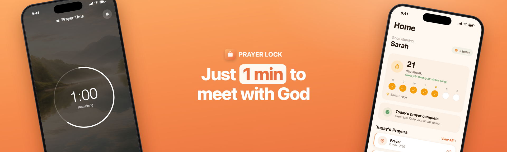
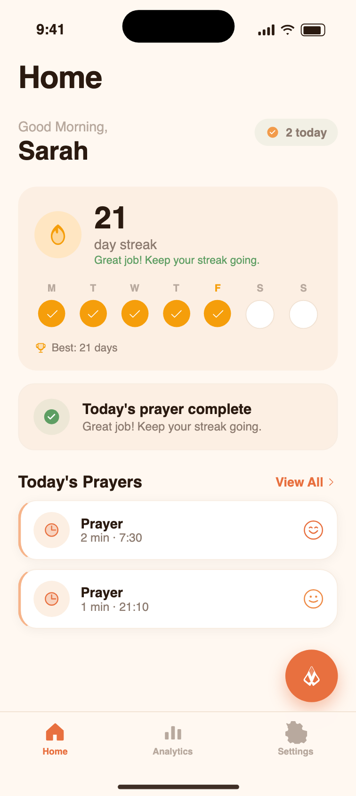
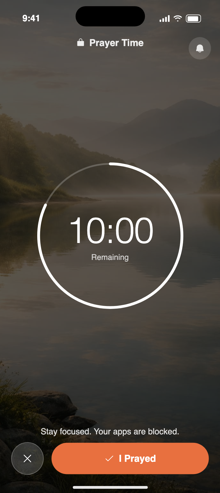
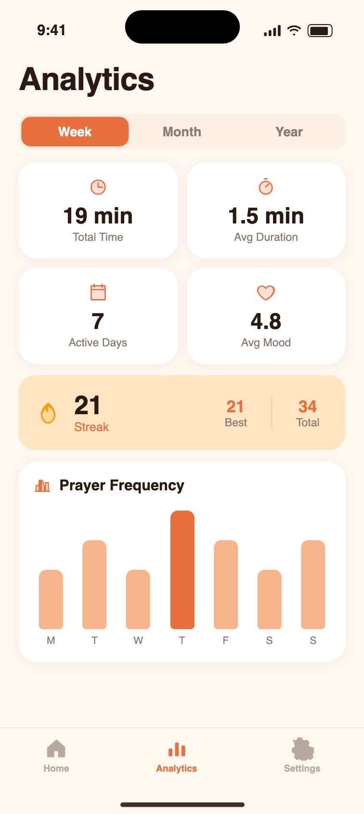

  

<h1 align="center">Prayer Lock</h1>

<b>Block distracting apps until you pray.</b> 
A Christian app blocker for iPhone and iPad that protects one unhurried prayer session a day.

  <a href="https://prayer-lock.com/">Website</a> ·
  <a href="https://apps.apple.com/app/prayer-lock-quiet-time/id6758918601">App Store</a> ·
  <a href="https://prayer-lock.com/blog/">Blog</a> ·
  <a href="https://prayer-lock.com/compare/">Compare</a> ·
  <a href="https://prayer-lock.com/about/">About</a> ·
  <a href="https://www.linkedin.com/company/prayer-lock/">LinkedIn</a>

---

This repository is the public engineering and product notebook for **Prayer Lock**. The app itself is proprietary and its source is private. What lives here:

- a plain description of what the app does and how it is built,
- write-ups of the hard problems we hit (Apple Screen Time, Android blocking, offline sync, widgets, subscriptions, App Store submission) and how we solved them,
- the product and growth decisions behind the app, with numbers where we have them.

If you are building on Apple's Screen Time API or shipping a React Native app with native extensions, the `docs/` folder is for you. If you are looking for the app, go to [prayer-lock.com](https://prayer-lock.com/) or the [App Store](https://apps.apple.com/app/prayer-lock-quiet-time/id6758918601).

## What Prayer Lock does

Most of us reach for the phone before we reach for God. Prayer Lock flips the order.

1. You pick a **daily prayer time** and the apps that pull you away: social media, news, games.
2. When the time comes, **Focus Mode blocks those apps** on your iPhone or iPad.
3. They stay locked until you finish praying and tap **"I Prayed"**. The rest of the day your phone works normally.

Prayer Lock is not a content app. There are no scripted prayers or sermons; you pray in your own words, with Scripture, or alongside any Bible or devotional app you already use. Its job is to clear the space and keep the habit honest: a daily streak, a history of sessions, a note of how you felt, home-screen widgets and gentle reminders.

Unlike per-open prayer prompts (apps that show a short prayer every time you open Instagram), Prayer Lock protects **one real, scheduled prayer session a day**. See the [comparison pages](https://prayer-lock.com/compare/) for how that differs from Pray Screen Time, GraceLock, PausePray, Bible Mode, Hallow and others.

  
  
  

## Facts

| | |
|---|---|
| Name | Prayer Lock - Quiet Time |
| Platforms | iPhone, iPad (iOS 16+). Android in development, [waitlist on the site](https://prayer-lock.com/) |
| Category | Lifestyle, Productivity |
| Pricing (US) | $39.99/year with a 7-day free trial, or $7.99/month. No ads, no data sale |
| Blocking | Apple Screen Time (FamilyControls, ManagedSettings, DeviceActivity), entirely on-device |
| Privacy | The app never reads the content of your prayers. [Privacy notes](docs/privacy.md) |
| Languages | English, Spanish, German, French, Portuguese, Russian, Ukrainian, Korean, Chinese, Arabic |
| Launched | June 2026 |
| Developer | [Daniil Yarmolenko](https://prayer-lock.com/about/), independent |
| Not to be confused with | "Prayer Lock: Christian Focus", "PrayLock", and a dozen similarly named apps |

## Tech stack

- **App**: React Native 0.83, Expo SDK 55, Expo Router, TypeScript
- **State and storage**: Zustand, MMKV (offline snapshot cache and mutation outbox)
- **Backend**: Supabase (Postgres, Auth with anonymous guest mode, RLS, edge functions)
- **Native iOS**: Swift Expo Module wrapping Screen Time; three app extensions (DeviceActivityMonitor, ShieldConfiguration, ShieldAction); App Group for shared state
- **Native Android**: Kotlin Expo Module; UsageStats foreground detection, `TYPE_APPLICATION_OVERLAY` shield, AlarmManager scheduling
- **Widgets**: [Voltra](https://github.com/callstackincubator/voltra) (React-defined WidgetKit and Glance widgets), Live Activity target
- **Payments**: RevenueCat (`react-native-purchases`), device-based entitlements
- **Observability**: Sentry, PostHog (product analytics and feature flags)
- **Delivery**: EAS Build and Submit, App Store Connect API scripts for listings, screenshots, custom product pages and A/B tests
- **Marketing site**: static HTML on GitHub Pages, 8 locales, JSON-LD, `llms.txt`. Repo: [prayer-lock-site](https://github.com/YarmolenkoD/prayer-lock-site)

## Engineering notes

Each note describes a real problem, what did not work, and what shipped.

| Doc | What it covers |
|---|---|
| [Architecture](docs/architecture.md) | Provider pattern for blocking, module layout, how JS talks to the Screen Time extensions |
| [Screen Time on iOS](docs/screen-time-ios.md) | The shield button cannot open your app (Apple limit) and the notification-based flow that works; shield colors are tints; extension point identifiers Apple actually accepts |
| [App blocking on Android](docs/android-blocking.md) | Why `startActivity()` from the background silently fails on Android 10+, the overlay shield, AlarmManager scheduling under Play policy |
| [Offline-first sync](docs/offline-first.md) | Snapshot cache, durable outbox, server-side streak recalculation, local-date correctness |
| [Home-screen widgets](docs/widgets.md) | Voltra rendering gotchas: gradients as roots, no asset-catalog images, never fill `placeholder()` |
| [Auth and guest mode](docs/auth-and-guest-mode.md) | App Store Guideline 5.1.1(v) rejection, Supabase anonymous auth with in-place upgrade, native Google sign-in nonce trap |
| [Subscriptions](docs/subscriptions.md) | RevenueCat package ids, device-based entitlements, trial eligibility, why production showed "Subscriptions unavailable" while TestFlight worked |
| [Shipping to the App Store](docs/shipping-ios.md) | Xcode image pin for a Swift compiler crash, symlinked `.appex` breaking the IPA, one distribution cert for five targets, Transporter 409 |
| [Growth and product](docs/growth.md) | Activation funnel numbers, why the first prayer is the leak, iPad share, ASO findings, SEO/GEO positioning |
| [Privacy](docs/privacy.md) | What is on-device, what is stored, what is never collected |

## Links

- Website: https://prayer-lock.com/
- App Store: https://apps.apple.com/app/prayer-lock-quiet-time/id6758918601
- Blog: https://prayer-lock.com/blog/
- Comparisons: https://prayer-lock.com/compare/
- About the developer: https://prayer-lock.com/about/
- LinkedIn: https://www.linkedin.com/company/prayer-lock/
- Marketing site source: https://github.com/YarmolenkoD/prayer-lock-site
- Wikidata: https://www.wikidata.org/wiki/Q142090834

Selected articles from the blog:

- [Why you check your phone before you pray](https://prayer-lock.com/blog/why-you-check-phone-before-you-pray.html)
- [Pray before checking your phone in the morning](https://prayer-lock.com/blog/pray-before-checking-phone-morning.html)
- [A Christian digital detox guide](https://prayer-lock.com/blog/christian-digital-detox-guide.html)
- [How to build a consistent prayer life](https://prayer-lock.com/blog/how-to-build-a-consistent-prayer-life.html)
- [Does a prayer streak help consistency?](https://prayer-lock.com/blog/does-a-prayer-streak-help-consistency.html)
- [Screen Time blocking to protect quiet time](https://prayer-lock.com/blog/screen-time-blocking-protect-quiet-time.html)

## License

The documentation in this repository is licensed under [CC BY 4.0](LICENSE.md). The Prayer Lock app, its source code, name and artwork are proprietary and not covered by that license.

## Contact

Questions about the Screen Time API, React Native native modules, or the app: open an issue here or write through [prayer-lock.com](https://prayer-lock.com/).
